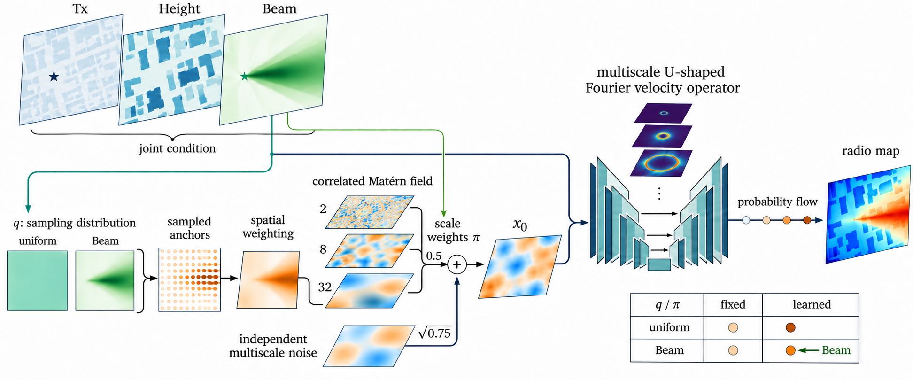
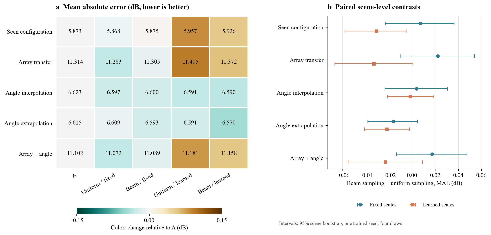
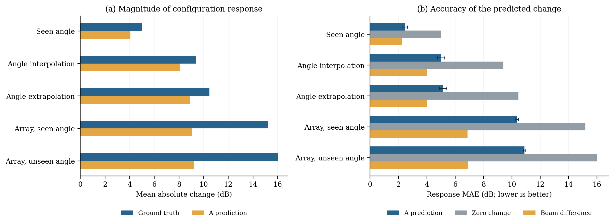

# FOMRadio：无线电图生成与 Beam–Matérn 噪声实验

本仓库整理原始 T3 方法、无辅助无线电图的 A 基线，以及围绕 Beam 信息和多尺度 Matérn 随机场的四组探索实验。代码、数据划分和结果范围分开说明，避免将不同推理输入的实验直接混为一谈。

## 四组实验的方法

四组都将 **Tx、建筑高度和目标 Beam Map 按通道联合输入**同一个带幅度–相位门控的 U 形 Fourier 速度网络；不使用目标或辅助 Radio Map。训练标签只用于训练损失，测试标签只在预测后用于评估。差别在初始随机场：

| 方案 | 噪声锚点概率 | Matérn 尺度权重 |
|---|---|---|
| 均匀 / 固定 | 均匀分布 | 三尺度等权 |
| Beam / 固定 | Beam 与 Beam 梯度构造的固定分布 | 三尺度等权 |
| 均匀 / 可学习 | 均匀分布 | 由 Beam 和梯度生成 |
| Beam / 可学习 | Beam 与 Beam 梯度构造的固定分布 | 由 Beam 和梯度生成 |

图中输入、场及结果为示意；Tx 通道实际是单点位置标记。两个可学习尺度变体都使用 Beam 来计算尺度权重。图仅概览主路径，省略的方差归一化与数学定义见[详细方法和公式](docs/beam_matern_method.md)。

这里的锚点只用于**生成模型内部的随机场**，不采集新的无线电标签。更准确的名称为 Beam-conditioned noise-anchor sampling，而不是主动测量或主动学习。原始 A 没有有限锚点采样，不能把它与“均匀 / 固定”视为完全相同的源。

## 数据划分与测试

实验使用 [U6G XL-MIMO Multi-config Radiomap](https://arxiv.org/abs/2603.06401)。本仓库不含数据集，需自行按提供方条款获取。场景按 [`splits/scene_ids_seed42.json`](splits/scene_ids_seed42.json) 划为 **560 / 80 / 160** 个训练 / 验证 / 测试场景；训练和验证均为 6.7 GHz、8×8 阵列、−14° / 0° / +14°。

| 测试任务 | 目标阵列 | 目标角度 | 查询数 |
|---|---|---|---:|
| 已见配置、未见场景 | 8×8 | −14°、0°、+14° | 480 |
| 跨阵列 | 32×32 | −14°、0°、+14° | 480 |
| 角度插值 | 8×8 | −7°、+7° | 320 |
| 角度外推 | 8×8 | −28°、−21°、+21° | 480 |
| 阵列与角度同时变化 | 32×32 | −28°、−21°、−7°、+7°、+21° | 800 |

上述四个噪声变体及对应的 A 参照各使用一次 **seed 42** 训练，每个查询测试 4 次内部噪声采样、8 步 Euler。此设置不能评估训练种子波动，也不能证明跨频率或跨空间离散网格的泛化。

## 结果

图中数字为 MAE（dB，越低越好）；右图的区间仅反映固定训练模型和既有噪声抽样下的场景差异。完整结果、分组指标、诊断和限制见[实验结果分析](docs/beam_matern_results.md)及[所有指标表](results/beam_matern/full_metrics.md)。

当前结果中，Beam / 可学习在角度外推组达到 **6.570 dB**，A 为 **6.615 dB**；但其跨阵列 MAE 为 **11.372 dB**，高于 A 的 **11.314 dB**。收益幅度与方向依赖任务，单次训练不能支持稳定优于 A 的结论。有限锚点、权重集中和直接 Beam 条件可能影响结果，但现有推理干预不足以判断单一原因。

## A 方案的 Beam 配置响应

为检查 A 如何响应新的 Beam，固定同一场景、Tx、建筑高度和初始噪声，分别生成两种配置下的无线电图，再比较预测变化与真实变化。该诊断使用原始 A 的两个独立训练种子和 160 个未见测试场景；每个场景使用 4 次配对噪声抽样，不输入辅助 Radio Map。

| 配置对 | A 的变化误差 ↓ | 零变化基线 ↓ | Beam 差值基线 ↓ |
|---|---:|---:|---:|
| 8×8，未见角度插值 | 5.007 | 9.392 | **4.017** |
| 8×8，未见角度外推 | 5.130 | 10.464 | **4.011** |
| 8×8→32×32，已见角度 | 10.355 | 15.180 | **6.865** |
| 8×8→32×32，未见角度 | 10.882 | 16.013 | **6.928** |

单位为 dB。表中是**两张图的变化量误差**，不能与上方单张图的 MAE 直接比较。A 对未见 Beam 有响应，但跨阵列时平均变化幅度偏小；直接 Beam 差值在本项变化预测中误差更低。Beam 差值只是变化量基线，不能在没有参考绝对功率的情况下独立生成完整目标图。详细设置、全部结果和证据边界见 [Beam 配置响应报告](docs/beam_response_diagnostic.md)。

## 原始 T3 的输入不同

[`t3/`](t3/) 保存原始 T3 代码和协议。T3 推理需要一张**同一场景下完整的 8×8 参考 Radio Map**，它与本页无辅助 Radio Map 的四组实验有不同信息条件；具体清单见 [T3 原始协议](t3/provenance/ORIGINAL_PROTOCOL.md)，请不要把两类数值直接解释为相同输入下的比较。

## 目录与复现

- [`docs/beam_matern_method.md`](docs/beam_matern_method.md)：四组共享骨干、源分布、可学习参数及 Flow Matching 公式。
- [`docs/beam_matern_results.md`](docs/beam_matern_results.md)：数据划分、指标、消融分析和证据边界。
- [`docs/beam_response_diagnostic.md`](docs/beam_response_diagnostic.md)：原始 A 的 Beam 角度与阵列响应诊断。
- [`results/beam_matern/`](results/beam_matern/)：单种子测试汇总、配对场景区间和验证诊断。
- [`results/beam_response/`](results/beam_response/)：双种子响应诊断的逐场景、逐配置对及分组结果。
- [`ac/`](ac/)：A 的共享实现、四组噪声源、训练 / 验证代码和固定查询清单；目录名称是历史沿用。
- [`assets/`](assets/) 与 [`scripts/`](scripts/)：方法示意图、数值结果图及结果图可编辑源码；数值图也提供 [PDF](assets/beam_matern_results.pdf) 和 [SVG](assets/beam_matern_results.svg)。
- [`t3/`](t3/)：原始方法和独立协议。

模型检查点、四组逐查询预测及原始数据未公开。本地训练入口经公开版路径和身份记录适配，**尚未完成公开版本的端到端重训验证**；不能仅凭该仓库复现原始指标或恢复原始检查点。代码和计算指标的运行依赖及操作边界见 [`ac/README.md`](ac/README.md)。
