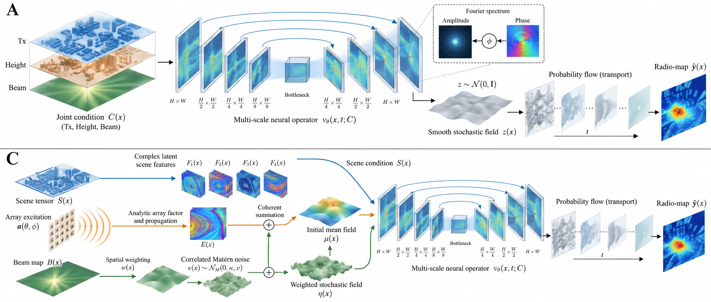

# FOMRadio：面向无线电图的算子流匹配

本仓库整理了基于 U6G 数据集的无线电图生成研究，包含原始 T3 方法、后续 A/C 探索性方案、数据划分和实验结果。两类实验使用的输入和训练目标不同，不能把它们的数值当作相同条件下的直接比较。

## 方法概览

> **读图说明：**上图是方法的视觉概念草图，部分连线和噪声标注与实际代码尚未完全一致。A 的源是具有空间相关性的多尺度 Matérn 高斯场，源场是速度网络运输的初始状态；C 则先由环境潜在基和解析激励计算均值，再将均值与噪声合成为初始场。实际数据流以代码和下方结构对照图为准。

- **T3：**推理时需要同一场景下真实的、完整的 8×8 参考 Radio Map。参考图既参与初始场构造，也作为速度网络的条件输入。
- **A：**不使用辅助 Radio Map。发射机位置图、建筑高度图和目标 Beam Map 按通道拼接为一个联合条件，同时用于输入提升和条件编码；初始场采用固定的多尺度 Matérn 噪声。
- **C：**不使用辅助 Radio Map。环境算子与解析阵列激励构造结构化源均值，目标 Beam Map 用于调节 Matérn 噪声的空间统计；Beam Map 不直接作为速度网络的条件输入。

按实际实现绘制的结构对照：[A 方案图](assets/method_a.pdf) · [C 方案图](assets/method_c.pdf) · [可编辑绘图脚本](ac/draw_method.py)。两张图的 SVG 和 PNG 版本也位于 [`assets/`](assets/)；A、C 的详细数学定义见 [LaTeX 源码](docs/proposed_methods.tex) 和 [PDF](docs/proposed_methods.pdf)。这些实现对照图中的特征平面和场均为示意，不是实测结果。

## 数据集与划分

实验使用 [U6G XL-MIMO Multi-config Radiomap 数据集](https://arxiv.org/abs/2603.06401)。原始数据需要按数据集提供方的使用条款单独获取，本仓库不包含原始 Radio Map 或处理缓存。

[`splits/scene_ids_seed42.json`](splits/scene_ids_seed42.json) 记录了互不重叠的 **560 个训练场景、80 个验证场景和 160 个测试场景**。本次 A/C 实验固定在 **6.7 GHz**：训练和验证使用 8×8 阵列，波束角度为 −14°、0° 和 +14°。160 个未见测试场景按以下配置展开：

| 测试任务 | 目标阵列 | 目标角度 | 查询数 |
|---|---:|---|---:|
| 已见配置、未见场景 | 8×8 | −14°、0°、+14° | 480 |
| 跨阵列 | 32×32 | −14°、0°、+14° | 480 |
| 未见角度插值 | 8×8 | −7°、+7° | 320 |
| 未见角度外推 | 8×8 | −28°、−21°、+21° | 480 |
| 跨阵列与角度 | 32×32 | −28°、−21°、−7°、+7°、+21° | 800 |

T3 的训练设置不同：它使用 32×32 目标图，训练角度为 −14°、0°、+14°，并使用真实的同场景 8×8、0° 参考图。原始查询和参考文件清单保存在 [`t3/manifests/`](t3/manifests/)，完整协议见 [T3 原始协议](t3/provenance/ORIGINAL_PROTOCOL.md)。

## A/C 测试结果

表中为每张图在有效像素上的 MAE，单位为 dB，数值越低越好。结果对每查询 4 次配对噪声采样、组内角度、160 个测试场景和种子 42、43 取平均；Euler 求解步数为 8。A 和 C 的信息路径、参数量与训练目标存在差异，表格反映的是**整体方案的表现**。

| 测试任务 | A MAE ↓ | C MAE ↓ |
|---|---:|---:|
| 已见配置、未见场景 | 5.855 | 7.666 |
| 跨阵列 | 11.545 | 16.719 |
| 未见角度插值 | 6.371 | 11.297 |
| 未见角度外推 | 6.421 | 11.534 |
| 跨阵列与角度 | 11.329 | 16.636 |

完整次要指标、逐种子结果、逐场景差值和配对 bootstrap 区间见 [`results/ac_two_seeds/`](results/ac_two_seeds/)。bootstrap 只对场景重采样，不能表示训练种子带来的全部不确定性。当前结果是已观测数据上的探索性分析，也不能据此证明跨频率或跨离散网格的泛化能力。

## C 方案表现较差的排查

目前 C 在五组任务中均落后于 A。现有证据可以定位几个值得关注的环节，但还不能将差距归因于某个单独模块。

1. **结构化源均值在配置变化时不稳定。**C 的结构化均值 MAE 在已见配置下为 **6.637 dB**，在跨阵列和角度插值任务中分别升至 **26.991 dB** 和 **24.100 dB**。Flow 精修降低了后两项误差，但最终结果仍落后于 A；在已见配置上，C 的最终 MAE 为 **7.666 dB**，高于均值本身。
2. **四个复数潜在基受到的训练激励约束不足。**三个训练角度产生的复数激励矩阵为 3×4，奇异值约为 **20.687、17.223、0.167**，至少存在一个未被训练激励覆盖的方向。这是潜在基可识别性方面的结构限制，其对测试误差的具体影响仍需消融验证。
3. **Beam 噪声路径在小规模干预中影响较弱。**固定模型权重、结构化均值与随机数后，将 Beam 概率图改为均匀分布，种子 42/43 的最终预测平均分别变化 **0.141/0.148 dB**；将噪声分支的 Beam 换为错误角度时，分别变化 **0.195/0.209 dB**。该干预只覆盖 6 个验证场景、5 个角度、8×8 阵列及每查询 1 次采样，属于推理期干预，不是重新训练的消融。
4. **源噪声尺度仍是待验证假设。**初始噪声在按 300 dB 缩放的归一化坐标中具有约为 1 的单点标准差。Flow 的中间状态是潜变量，数值范围大本身不等于实现错误；A 也使用相同噪声尺度，需要在相同条件下重训才能判断其影响。

更详细的实验范围、逐组结果与验证记录见 [C 方案排查报告](docs/c_diagnostics.md)。结构化均值、移除 Beam 直连和噪声调制同时改变，后续需要固定数据、预算和种子，分别进行单因素重训消融。

## 目录与复现说明

- [`t3/`](t3/)：原始 T3 代码、训练与评估入口、参考图协议和数据清单。
- [`ac/`](ac/)：A/C 模型代码、测试、指标定义和实验配置。
- [`assets/`](assets/)：联合概念图、按代码绘制的 A/C 结构图及矢量版本。
- [`splits/`](splits/)：场景 ID 划分。
- [`results/ac_two_seeds/`](results/ac_two_seeds/)：测试汇总、逐查询记录、固定场景可视化和 C 排查数据。
- [`docs/`](docs/)：方法公式与 C 方案排查报告。

**仓库暂未包含模型权重。**T3 和 A/C 的检查点需要另行获取，因此仅凭当前仓库尚不能复现预训练模型推理。`t3/README.md` 中对完整本地包的描述已加注说明。

A/C 评估使用 Linux、PyTorch 2.5.1+cu121、NumPy 1.26.4、SciPy 1.13.1 和 NVIDIA RTX 3090。运行 [`ac/evaluate_test_ac.py`](ac/evaluate_test_ac.py) 前，应将环境变量 `U6G_DATASET_ROOT` 指向解压后的数据集。公开版评估脚本用该环境变量替换了原机器上的数据路径，数值运算保持不变；公开脚本和另行取得的权重仍需要独立端到端复现检查。

C 的四个复数环境基是模型学习到的潜在表示，不能直接认定为真实传播路径或已测量的复数信道。已检查的 Beam Map 在典型像素上与视距计算约定接近，但数据集元数据与码本约定仍存在尚未完全解决的差异。

公开版 [`ac/plan_frozen.md`](ac/plan_frozen.md) 将一个本机路径替换为 `t3/`，并同步更新了 `ac/test_run_spec.json` 中的摘要。原始测试记录保留实验时的计划及源码摘要，不能与新生成记录混作同一断点续跑单元。`raw/` 目录保存逐查询指标，不含预测图或 Radio Map。
