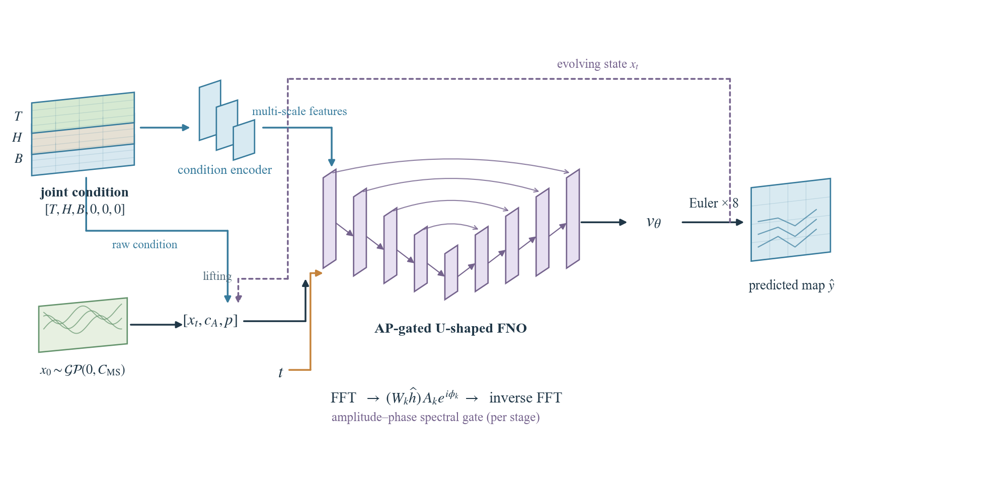
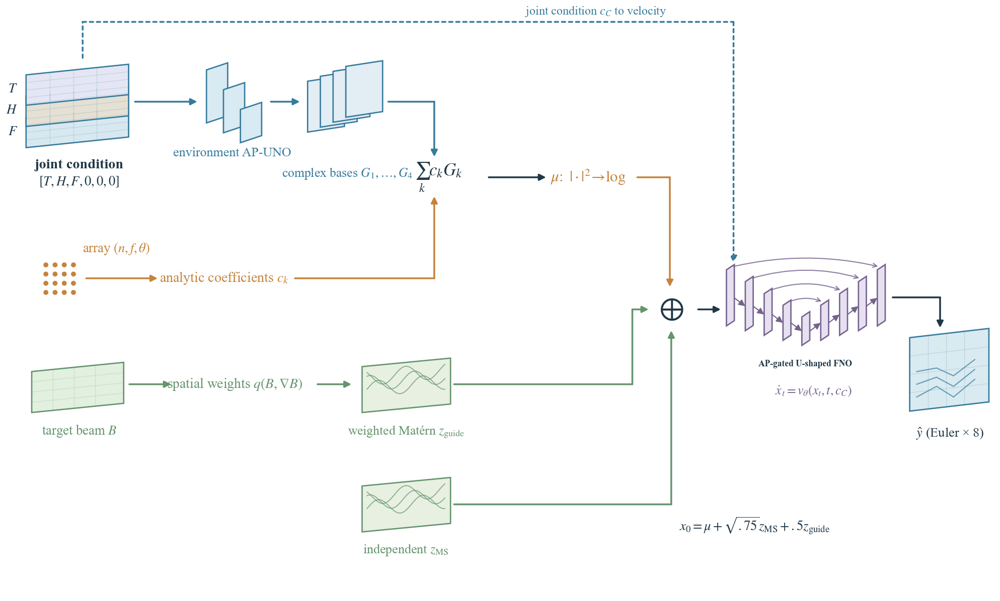

# FOMRadio: Operator Flow Matching for Radio Maps

This repository collects two distinct U6G research experiments:

* **T3:** an archived cross-array flow-matching model that requires a complete same-scene 8×8 reference radio map at inference.
* **A/C:** exploratory models without an auxiliary or target radio map at inference. A jointly concatenates the transmitter map, height map, and target beam map as its velocity condition; C combines a separate environmental operator, analytic array excitation, and beam-conditioned Matérn noise.

The two protocols use different inputs and training targets. Their results must not be presented as an identical-input comparison. A/C results are exploratory: earlier results had already been inspected, and the user selected two training seeds after the original plan.

The detailed, implementation-aligned mathematical descriptions of both
variants are in [`docs/proposed_methods.tex`](docs/proposed_methods.tex).
The diagrams are available as vector PDF and SVG files in `assets/` and are
generated by the editable Python source [`ac/draw_method.py`](ac/draw_method.py).

## Dataset and split

The official [U6G XL-MIMO Multi-config Radiomap dataset](https://arxiv.org/abs/2603.06401) is obtained separately under its provider's terms. `splits/scene_ids_seed42.json` records the exact disjoint **560 training / 80 validation / 160 test scenes**. Raw maps and processed caches are not redistributed.

All A/C experiments here use **6.7 GHz**. Training and validation use 8×8 arrays and steering angles −14°, 0°, and +14°. The 160 held-out scenes are evaluated as follows:

| Test group | Target array | Steering angles | Queries |
|---|---:|---|---:|
| Seen configuration | 8×8 | −14°, 0°, +14° | 480 |
| Array transfer | 32×32 | −14°, 0°, +14° | 480 |
| Angle interpolation | 8×8 | −7°, +7° | 320 |
| Angle extrapolation | 8×8 | −28°, −21°, +21° | 480 |
| Array + angle transfer | 32×32 | −28°, −21°, −7°, +7°, +21° | 800 |

The archived T3 instead trains on **32×32 targets** at −14°/0°/+14°, with a real 8×8/0° reference map. Its manifests in `t3/manifests/` retain the original target and reference file identities; see `t3/provenance/ORIGINAL_PROTOCOL.md`.

## A/C test results

Per-image MAE in dB, averaged across four paired noise draws, the angles in each group, the 160 test scenes, and seeds 42 and 43. Euler NFE is 8. Lower is better. A and C use different information paths and C has additional parameters, so differences are system-level.

| Group | A MAE ↓ | C MAE ↓ |
|---|---:|---:|
| Seen configuration | 5.855 | 7.666 |
| Array transfer | 11.545 | 16.719 |
| Angle interpolation | 6.371 | 11.297 |
| Angle extrapolation | 6.421 | 11.534 |
| Array + angle transfer | 11.329 | 16.636 |

Full secondary metrics, per-seed results, scene-paired bootstrap intervals, and per-scene differences are in `results/ac_two_seeds/`. The bootstrap resamples scenes; it does not represent the full uncertainty across training seeds. These results do not establish cross-frequency or discretization-transfer generalization.

## Why C underperforms: diagnostic evidence

The observed gap occurs even on seen array/angle configurations, then grows
under held-out configurations. The following diagnostics identify where the
current C system struggles; they do not isolate a single causal component.

* **The structured mean does not reliably transfer.** On held-out scenes its
  MAE rises from **6.637 dB** for seen configurations to **26.991 dB** for
  array transfer and **24.100 dB** for angle interpolation. Flow refinement
  reduces these latter errors but does not close the gap to A. On seen
  configurations, the refined output averages **7.666 dB**, above its
  structured mean's **6.637 dB**.
* **The four complex bases are weakly constrained by training excitation.**
  The three training angles produce a `3 × 4` complex excitation matrix with
  singular values approximately `20.687, 17.223, 0.167` and at least one
  null direction. This is a concrete identifiability limitation, while its
  causal contribution to test MAE remains to be established.
* **The beam-to-noise path has a small effect in a limited intervention.**
  With the trained weights, mean, and random draws fixed, replacing the
  beam-derived probability map with a uniform map changed predictions by
  **0.141/0.148 dB** for seeds 42/43; substituting a different beam changed
  them by **0.195/0.209 dB**. This probe used six validation scenes, five
  angles, an 8×8 array, and one draw. It is an inference intervention, not a
  retrained ablation and not proof that beam-conditioned noise is ineffective
  for other configurations.
* **Source scale is a further hypothesis.** The initial noise has unit
  standard deviation in a representation normalized by 300 dB. Intermediate
  flow states are latent variables, so their large numerical range is not
  itself an implementation error. A uses the same noise scale; its causal
  role requires matched retraining.

The [detailed diagnosis](docs/c_diagnostics.md) links the aggregated test and
validation-probe records. A and C differ in more than one design choice, so a
single-factor retraining study is needed before assigning blame to the
structured mean, removal of direct beam conditioning, or noise modulation.

## Repository layout and availability

* `t3/`: archived T3 source, training/evaluation entry points, source-observation protocol and record manifests.
* `ac/`: A/C source, tests, test configuration, metric definitions and frozen exploratory plan.
* `splits/`: exact scene ID lists.
* `results/ac_two_seeds/`: verified aggregate test results and fixed-scene visualizations.

Model weights are **not included in this source snapshot**. The T3 checkpoint and A/C best checkpoints must be obtained separately from the authors; their absence prevents reproducing pretrained inference from this repository alone. The original T3 README discusses the complete local package and is qualified by a note in `t3/README.md`.

The A/C evaluation snapshot was run on Linux, PyTorch 2.5.1+cu121, NumPy 1.26.4, SciPy 1.13.1 and NVIDIA RTX 3090 GPUs. Set `U6G_DATASET_ROOT` to the extracted dataset for `ac/evaluate_test_ac.py`. The public copy substitutes that environment variable for the original machine-specific dataset path; the numerical model and metric operations are unchanged. Result metadata retain the hashes of the original experimental source files, not the edited release copy. The released scripts and missing weights still require an independent end-to-end reproduction check.

## Interpretation

C's four complex environmental bases are learned latent representations, not verified physical propagation paths or measured complex channels. Published beam maps match the checked LoS convention in typical pixels, but dataset metadata and codebook conventions have unresolved differences. No auxiliary or target radio map is an A/C inference input; target labels and validity masks are used for offline evaluation.

The release copy of `ac/plan_frozen.md` replaces one machine-specific path with `t3/`; its digest in `ac/test_run_spec.json` is updated accordingly. Original test records retain the original plan and source hashes, so they cannot be mixed with newly generated records as resumable units. The `raw/` directory contains individual test-metric records, not prediction images or radio maps.
