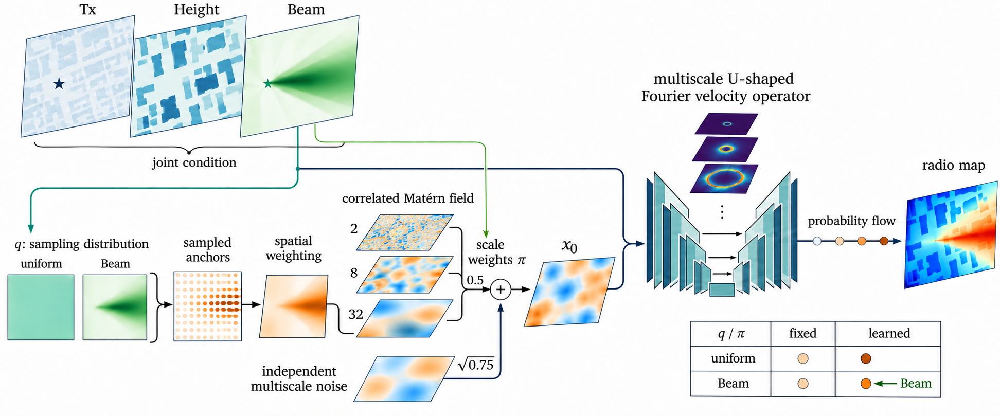

# 四组 Beam–Matérn 实验：方法与实现

本文记录已经运行的单种子实验。四组实验共享 A 的速度网络、联合条件、数据划分及训练目标，仅改变初始随机场的锚点分布和尺度权重；这里的采样对象是**模型内部的噪声锚点**。图中所有场和输入图像均为示意，并非实验预测；实际 Tx 通道仅包含一个发射位置标记。

图中绿色连线表示 Beam 可用于生成锚点概率或尺度权重：只有 `beam_*` 使用 Beam 构造锚点概率，两个 `*_learned` 均使用 Beam 构造尺度权重，包括 `uniform_learned`。图中省略了引导场的逐点条件方差归一化和训练损失，具体以以下公式及源码为准。图示傅里叶特征不是电磁波的实测物理相位。

## 四种配置的公式

四组共享同一个源构造，分别选择锚点分布 $q$ 和尺度权重 $\pi$。以下符号中的尺度 $\ell\in\{2,8,32\}$ 均以 $256\times256$ 网络网格的像素计。设 $N=256^2$，原始 Beam 经裁剪、归一化和插值得到 $\bar B$；其梯度幅值经训练集尺度 $s_{95}=0.02020273543894291$ 归一化：

$$
g_i=\operatorname{clip}\!\left(
\frac{\|\nabla\bar B_i\|}{s_{95}},0,1\right),\qquad
q_i^{\mathrm U}=\frac1N.
$$

Beam 引导分布、固定尺度权重和可学习尺度权重分别为

$$
q_i^{\mathrm B}
=0.8\frac{\exp(\bar B_i+g_i)}
{\sum_{j=1}^{N}\exp(\bar B_j+g_j)}
+\frac{0.2}{N},
$$

$$
\pi_{\ell i}^{\mathrm F}=\frac13,\qquad
\pi_{\ell i}^{\mathrm L}
=0.95\,\operatorname{softmax}_{\ell}
\!\left(h_\phi([\bar B,g])_i\right)+\frac{0.05}{3}.
$$

$h_\phi$ 对每个位置输出三个尺度的 logits；可学习尺度组才更新其参数。四种配置具体是：

| 配置 | 锚点概率 $q_i$ | 尺度权重 $\pi_{\ell i}$ |
|---|---|---|
| 均匀 / 固定 | $q_i^{\mathrm U}=1/N$ | $\pi_{\ell i}^{\mathrm F}=1/3$ |
| Beam / 固定 | $q_i^{\mathrm B}$ | $\pi_{\ell i}^{\mathrm F}=1/3$ |
| 均匀 / 可学习 | $q_i^{\mathrm U}=1/N$ | $\pi_{\ell i}^{\mathrm L}$ |
| Beam / 可学习 | $q_i^{\mathrm B}$ | $\pi_{\ell i}^{\mathrm L}$ |

给定表中选定的 $q$，有放回抽取 $K=4096$ 个内部锚点，记每个位置被抽中的次数为 $n_i$。四组采用同一公式将锚点与尺度权重转成源场：

$$
(n_1,\ldots,n_N)\sim\operatorname{Multinomial}(K;q_1,\ldots,q_N),
\qquad
\rho_i=0.5+0.5\frac{Nn_i}{K},
$$

$$
z_\ell=G_\ell(\sqrt{\rho}\,\epsilon_\ell),\quad
D_\ell(i)=\operatorname{Var}[z_\ell(i)\mid\rho],\quad
z_{\mathrm g}(i)=
\frac{\sum_\ell\sqrt{\pi_{\ell i}}z_\ell(i)}
{\sqrt{\sum_\ell\pi_{\ell i}D_\ell(i)}},
$$

$$
x_0(i)=\sqrt{0.75}\,z_{\mathrm{MS}}(i)+0.5\,z_{\mathrm g}(i).
$$

这里 $G_\ell$ 是第 $\ell$ 个 Matérn 滤波器， $\epsilon_\ell$ 是各尺度独立白噪声， $D_\ell$ 是滤波后按锚点条件计算的逐点方差； $z_{\mathrm{MS}}$ 是与引导分支独立的三尺度基础场。实现对方差分母使用数值下界，并对扩展区域做边界处理。 $q$ 的规则固定且锚点抽样不反向传播；可学习尺度权重通过源场和训练损失更新。四组分别训练，不共享已训练参数。

## 1. 任务与共享速度网络

训练样本由目标无线电图 $y$、发射位置图 $T$、建筑高度 $H$、目标 Beam Map $B$ 构成。推理只使用 $T,H,B$ 和内部采样噪声，不读取目标或辅助 Radio Map。条件张量为

$$
c=[T,H,B,0,0,0].
$$

三个有效通道是**联合输入**，不是三个独立编码器。[`QueryLoader`](../ac/dataset.py) 将高度和 Beam 归一化后，在 256 × 256 网格构造输入；参考标签的原始分辨率为 128 × 128。场景、目标阵列与角度定义见[结果报告](beam_matern_results.md)。

速度网络为带幅度–相位门控的 U 形 Fourier neural operator（UNO，宽度 32）：条件经过共享编码器，状态 $x_t$、条件及二维坐标进入特征提升层；编码器与解码器以跳跃连接融合多尺度特征，谱算子提供跨位置的全局耦合，时间嵌入和条件特征调节速度场。其 AP 门控作用在潜在 Fourier 系数上，代码中形式为

$$
g=(1+0.5\tanh a)\exp\!\left(i\frac{\pi}{4}\tanh b\right),
$$

其中 $a,b$ 由条件和当前特征产生。门控中的相位是**潜在特征相位**，不能直接解释为真实的电磁传播相位。四组的速度网络结构相同，各自独立训练；模型代码在 [`ac/vendor/cross_array/model.py`](../ac/vendor/cross_array/model.py) 和 [`ac/vendor/model/spectral_gate_uno.py`](../ac/vendor/model/spectral_gate_uno.py)。

## 2. 多尺度 Matérn 基线

代码使用平滑度 $\nu=1$ 的相关高斯随机场，三个相关尺度分别为 $\ell\in\{2,8,32\}$，单位是**网络输入网格像素**。单尺度核满足 $C_\ell(r)=(r/\ell)K_1(r/\ell)$， $C_\ell(0)=1$。在保持独立随机流时，A 的初始场可写为

$$
z_{\mathrm{MS}}\sim\mathcal{GP}\!\left(0,\frac{C_2+C_8+C_{32}}{3}\right),\quad
x_0^{A}=\sqrt{0.75}\,z_{\mathrm{MS}}+\frac{0.5}{\sqrt3}\sum_{\ell}z_\ell.
$$

这里的 $z_{\mathrm{MS}}$ 与三项 $z_\ell$ 使用独立随机流。四个变体保留前一个基础场，但将第二项改为有限锚点调制的随机场。**有限均匀锚点并不等同于原始 A**；它仅在锚点调制强度取零并满足相同随机流条件时退化到 A 的源构造。

## 3. 从 Beam 到有限噪声锚点

记 $N=256^2$， $\bar B_i$ 为归一化 Beam， $g_i$ 为梯度幅值除以训练集梯度尺度后截断到 $[0,1]$。固定规则取 $\alpha=\beta=\tau=1$、 $\eta=0.2$：

$$
q_i^{\mathrm{beam}}=0.8\,\frac{\exp(\bar B_i+g_i)}{\sum_j\exp(\bar B_j+g_j)}+\frac{0.2}{N},
\qquad q_i^{\mathrm{uniform}}=\frac{1}{N}.
$$

从 $q$ 有放回采样 $K=4096$ 次，记网格 $i$ 被抽中的次数为 $n_i$。用采样计数构造局部白噪声方差系数：

$$
\rho_i=(1-\lambda)+\lambda\frac{N n_i}{K},\qquad \lambda=0.5.
$$

对每个尺度用独立白噪声 $\epsilon_\ell$，经 Matérn 滤波算子 $G_\ell$ 得到 $z_\ell=G_\ell(\sqrt\rho\,\epsilon_\ell)$；其条件逐点方差记为 $D_\ell$，由 $\rho$ 与滤波核平方的卷积计算。** $q$ 的规则和参数在四组中均固定，离散抽样不反传训练 $q$**。实际实现包括边界扩展和条件方差归一化，见 [`anchor_source.py`](../ac/anchor_source.py) 与 [`beam_matern_source.py`](../ac/beam_matern_source.py)。

## 4. 固定与可学习尺度权重

固定尺度时 $\pi_\ell(i)=1/3$。可学习尺度时，对 $[\bar B,g]$ 使用 `Conv2d(2,16,3) → GELU → Conv2d(16,3,1)`，产生每个位置的三维 logits $h_\phi(i)$，参数量为 355：

$$
\pi_\ell(i)=0.95\,\operatorname{softmax}_{\ell}(h_\phi(i))+\frac{0.05}{3}.
$$

该网络初始输出为等权；只有 `*_learned` 组更新其参数。即使 $q$ 均匀，可学习尺度也仍直接接收 Beam。引导场和最终源为

$$
z_{\mathrm g}(i)=\frac{\sum_\ell \sqrt{\pi_\ell(i)}\,z_\ell(i)}{\sqrt{\sum_\ell\pi_\ell(i)D_\ell(i)}},
\qquad x_0=\sqrt{0.75}\,z_{\mathrm{MS}}+0.5\,z_{\mathrm g}.
$$

数值计算对分母使用下界以保证稳定；这是按**理论条件方差**逐点归一化，不是对每次样本做整体标准化。因归一化，Beam 的主要作用是改变引导分支的空间统计，而不是直接指定预测图的均值。参见 [`beam_scale_source.py`](../ac/beam_scale_source.py)。

| 变体 | 锚点概率 $q$ | 尺度权重 $\pi$ | 可学习的源参数 |
|---|---|---|---|
| `uniform_fixed` | 均匀 | 固定等权 | 无 |
| `beam_fixed` | Beam 与梯度的固定规则 | 固定等权 | 无 |
| `uniform_learned` | 均匀 | Beam 条件下逐像素学习 | 355 个尺度网络参数 |
| `beam_learned` | Beam 与梯度的固定规则 | Beam 条件下逐像素学习 | 355 个尺度网络参数 |

## 5. Flow matching 与求解

训练使用直线路径 $x_t=(1-t)x_0+ty$，目标速度为 $y-x_0$， $t\sim U[0,1]$。损失由有效像素上的 flow matching 项与两级 Haar 细节项组成：

$$
\mathcal L=\mathcal L_{\mathrm{FM}}+0.05\mathcal L_{\mathrm{Haar},1}+0.05\mathcal L_{\mathrm{Haar},2}.
$$

梯度同时更新速度网络和启用的尺度网络；固定 $q$ 不更新。所有模型使用 AdamW、初始学习率 $10^{-3}$、权重衰减 $10^{-5}$，全局 batch 128；训练最多 5000 次更新，每 250 次用验证集选择检查点。测试使用 8 步 Euler、每个查询 4 次配对源采样。

## 6. 实验边界

这是一项**无辅助 Radio Map 的条件生成**实验。目标 Beam 在推理时可用，且同时进入速度网络与（对应组的）噪声源；Beam 是目标配置的信息，不能称为对目标无线电图的测量。这里的“锚点采样”并未决定到哪里采集新的真实标签，也不根据新观测迭代更新模型，因此更准确的名称是 *Beam-conditioned noise-anchor sampling*，不应宣称已完成主动测量或主动学习。四组均只在 6.7 GHz 训练和测试，不能证明跨频率泛化或网格分辨率不变性。
