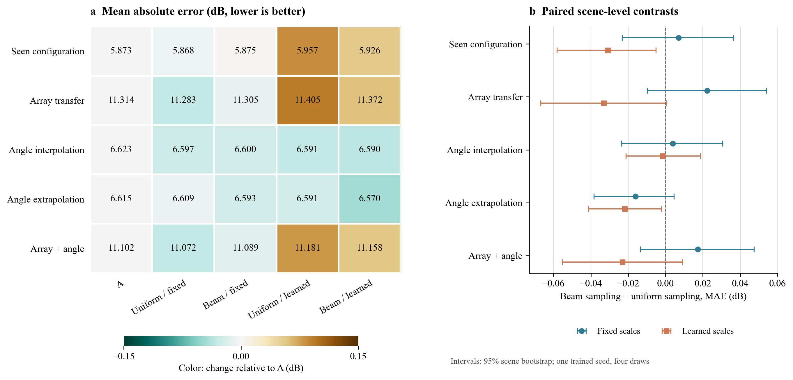

# 四组 Beam–Matérn 实验：配置、结果与分析

## 实验要回答的问题

在不提供辅助 Radio Map、保留 A 的联合条件和 FNO 速度网络的前提下，研究有限噪声锚点的位置分布和多尺度权重是否改变生成结果。原始 A 作为单独参照，四个新变体构成 2 × 2 对照：均匀或 Beam 引导的锚点概率 $q$，以及固定或可学习的尺度权重 $\pi$。详细代码与公式见[方法说明](beam_matern_method.md)。

## 四种配置如何定义

令 $N=256^2$， $\bar B$ 和 $g$ 分别为网络网格上的归一化 Beam 及归一化梯度幅值， $h_\phi$ 为三个尺度的可学习 logits。两种锚点分布和两种尺度权重为

$$
q_i^{\mathrm U}=\frac1N,\qquad
q_i^{\mathrm B}=0.8\frac{\exp(\bar B_i+g_i)}
{\sum_j\exp(\bar B_j+g_j)}+\frac{0.2}{N};
$$

$$
\pi_{\ell i}^{\mathrm F}=\frac13,\qquad
\pi_{\ell i}^{\mathrm L}
=0.95\,\operatorname{softmax}_{\ell}(h_\phi([\bar B,g])_i)+\frac{0.05}{3}.
$$

| 实验配置 | $q_i$ | $\pi_{\ell i}$ |
|---|---|---|
| 均匀 / 固定 | $q_i^{\mathrm U}$ | $\pi_{\ell i}^{\mathrm F}$ |
| Beam / 固定 | $q_i^{\mathrm B}$ | $\pi_{\ell i}^{\mathrm F}$ |
| 均匀 / 可学习 | $q_i^{\mathrm U}$ | $\pi_{\ell i}^{\mathrm L}$ |
| Beam / 可学习 | $q_i^{\mathrm B}$ | $\pi_{\ell i}^{\mathrm L}$ |

尺度 $\ell$ 为 2、8、32 个网络网格像素。 $q$ 是固定规则，可学习组更新的是 $h_\phi$，不是 $q$。锚点采样、逐点方差归一化与源场合成的完整公式见[方法说明](beam_matern_method.md#四种配置的公式)。

## 训练、验证与测试配置

U6G 场景按 ID 严格划分为 **560 个训练、80 个验证、160 个测试场景**；原始 ID 见 [`scene_ids_seed42.json`](../splits/scene_ids_seed42.json)。训练与验证都在 6.7 GHz、8×8、−14°/0°/+14° 下进行，共 1680 / 240 个场景—配置查询。五组测试都使用未参与训练和验证的 160 个场景：

| 测试组 | 阵列 | 角度 | 查询数 |
|---|---|---|---:|
| 已见配置、未见场景 | 8×8 | −14°、0°、+14° | 480 |
| 跨阵列 | 32×32 | −14°、0°、+14° | 480 |
| 角度插值 | 8×8 | −7°、+7° | 320 |
| 角度外推 | 8×8 | −28°、−21°、+21° | 480 |
| 跨阵列与角度 | 32×32 | −28°、−21°、−7°、+7°、+21° | 800 |

一个查询是一个场景与目标配置的组合；每个查询测试 4 次配对的内部噪声抽样，8 步 Euler。四组分别训练一次（seed 42）；四次抽样**不是四个训练种子**。目标 Radio Map 用于训练损失和预测完成后的评估，不作为推理输入。此实验不涉及跨频率结果。

## 总体结果

图左的数值是 MAE，底色表示相对 A 的变化；图右以同一测试场景配对，画出 Beam 锚点减去均匀锚点的 MAE 差，负数表示 Beam 较低。区间为 160 个场景的 95% bootstrap 区间，条件于一组已训练模型和四次既有抽样，**不包括重训随机性**。结果已被查看，属于探索性分析。

| 测试组 | A | 均匀 / 固定 | Beam / 固定 | 均匀 / 可学习 | Beam / 可学习 |
|---|---:|---:|---:|---:|---:|
| 已见配置 | 5.873 | **5.868** | 5.875 | 5.957 | 5.926 |
| 跨阵列 | 11.314 | **11.283** | 11.305 | 11.405 | 11.372 |
| 角度插值 | 6.623 | 6.597 | 6.600 | 6.591 | **6.590** |
| 角度外推 | 6.615 | 6.609 | 6.593 | 6.591 | **6.570** |
| 跨阵列与角度 | 11.102 | **11.072** | 11.089 | 11.181 | 11.158 |

单位为 dB，越低越好。完整的 RMSE、PSNR、SSIM 和边界 MAE 见[分组指标表](../results/beam_matern/full_metrics.md)；[原始汇总 JSON](../results/beam_matern/summary.json) 保留未四舍五入结果。

### 现象 1：直接引入 Beam 采样没有一致优势

固定尺度时，Beam 相对均匀采样的 MAE 差依次为 +0.007、+0.022、+0.004、−0.016 和 +0.017 dB；五个对应的场景区间都跨过 0。可学习尺度时，这些差分别为 −0.031、−0.033、−0.001、−0.022 和 −0.023 dB；其中已见配置和角度外推的场景区间位于 0 以下，但结果仍只对应单次训练，不能据此认定可重复的泛化收益。

### 现象 2：学习尺度不一定更好

相同 $q$ 下，两个可学习尺度方案在跨阵列和联合变化上均高于其固定尺度对应项：例如均匀 $q$ 下跨阵列从 11.283 升至 11.405 dB；Beam $q$ 下从 11.305 升至 11.372 dB。角度外推则反向变化：Beam $q$ 下从 6.593 降至 6.570 dB。该现象说明当前设置存在任务依赖，而非可以普遍宣称“可学习尺度更优”。

在 `beam_learned` 的一个最佳检查点上，对 12 个验证场景、3 个角度及 8×8/32×32 配置的分析显示，2/8/32 像素尺度的名义权重均值约为 **1.7% / 1.8% / 96.5%**；重算条件方差后，32 像素尺度占**引导分支内部**约 96.6%。这不是整个源场的 96.6%，也不能单凭该现象断言模型学到了某种真实传播尺度。范围与检查点见 [`scale_variance.json`](../results/beam_matern/scale_variance.json)。

### 现象 3：跨阵列误差明显更高

各方案 8×8 组 MAE 大致为 5.9–6.6 dB，而 32×32 组约为 11.1–11.4 dB。对当前切分和模型而言，目标阵列变化仍是主要困难之一。由于联合任务同时改变阵列与角度，不能将其误差独立归因于阵列大小。

## 为什么噪声分支的效果可能较小？

已有验证干预选取 12 个场景、3 个训练角度、8×8 和 32×32，每个查询只采样一次。在 `beam_fixed` 中，仅替换速度网络的 Beam 条件，预测图平均变化约 5.91 / 6.71 dB；仅将源分布 $q$ 换成均匀分布，预测图变化约 0.41 / 0.46 dB，而只重采样锚点位置也约为 0.41 / 0.46 dB。两组数值来自不同强度的分布外干预，**不能视为网络对不同输入的信息贡献排序，也不能证明直接 Beam 路径绝对主导**。换 Height 也会引起较大变化；详细数值和范围见 [`validation_interventions.json`](../results/beam_matern/validation_interventions.json)。

根据实现，还存在几种合理但未被证明的解释：锚点有限采样的波动可能掩盖分布差异；引导场占总源单点方差约四分之一；逐点方差归一化限制了 Beam 直接改变单点方差；速度网络已可直接读取 Beam。它们是下一轮消融的假设，而非单一原因的结论。

要区分直接条件与源路径，可固定网络结构、数据和训练预算，从头比较：速度网络 Beam 通道有/无 × 噪声源 Beam $q$ 有/无。没有直接 Beam 且没有 Beam 噪声时，同一场景不同目标配置可能不可辨识，应明确说明这一任务限制。增加独立训练种子并逐场景配对，才可估计训练波动。

## 可复查材料

- [`summary.json`](../results/beam_matern/summary.json)、[`summary.csv`](../results/beam_matern/summary.csv)：五组、五个模型的所有汇总指标。
- [`paired_stats.json`](../results/beam_matern/paired_stats.json)：按场景配对的对照与 bootstrap 区间。
- [`validation_interventions.json`](../results/beam_matern/validation_interventions.json)：小范围推理期路径干预。
- [`scale_variance.json`](../results/beam_matern/scale_variance.json)：尺度权重及引导分支条件方差。
- [`plot_beam_results.py`](../scripts/plot_beam_results.py)、[`build_metrics_tables.py`](../scripts/build_metrics_tables.py)：由归档汇总重新生成结果图和完整指标表。

当前未公开四组逐查询输出及模型检查点，也未验证公开仓库的端到端训练与评估；因此无法仅凭本仓库独立复现完整数值。原始记录与检查点应以生成这些结果的实验环境为准。
