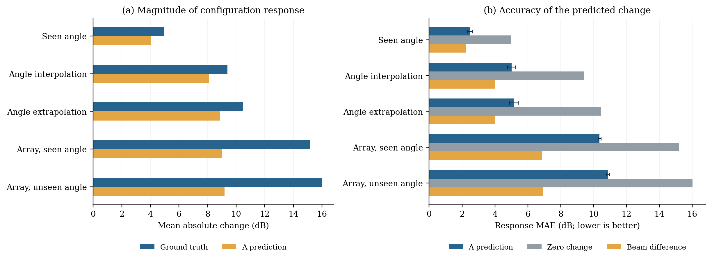

# A 方案的 Beam 配置响应实验

## 结论

A **会响应未见 Beam，且其预测变化并非接近零**。但在本次 U6G 跨阵列测试中，它低估了功率图随配置变化的整体幅度；在所比较的响应指标上，直接使用 Beam Map 差值更准确。该结果支持“当前 A 对配置变化的利用仍不充分”这一问题，但不能单独证明特征耦合或训练覆盖不足是唯一原因。

图 (a) 为真实与预测变化的平均绝对幅度；图 (b) 为变化预测的 MAE。横线是对测试场景的 95% bootstrap 区间，条件于现有两套检查点与四次噪声抽样，不包含充分的重训不确定性。图中 “seen angle” 只表示角度见于训练：32×32 阵列始终未见于训练。

## 设置

- **模型**：原始 A，而非四个后续 Beam–Matérn 锚点变体。冻结 seed 42、43 的最佳验证检查点，分别位于训练第 5000、4750 步。
- **训练条件**：560 个场景，6.7 GHz、8×8、−14°/0°/+14°；每个场景均有三个训练角度。测试使用互不重叠的 160 个场景。
- **输入**：Tx 位置、高度图和目标 Beam Map 联合输入；无辅助或目标 Radio Map。测试改变 8×8/32×32 和八个角度，频率固定 6.7 GHz。
- **随机性**：每个场景四次 Matérn 抽样；在同一场景、同一次抽样内，所有目标配置复用完全相同的初始场。两套模型使用独立训练种子；四次内部抽样不是四次独立训练。
- **预测与计分**：每个场景的全部配置先完成无标签推理，再加载真实图。使用两张真实图均有效的像素交集，按场景、角度、抽样和训练种子等权汇总；平均有效区域占 92.36%。

对一对配置，记 $\Delta y=y_2-y_1$、 $\Delta\hat y=\hat y_2-\hat y_1$，单位均为 dB。主要指标是 $\operatorname{mean}|\Delta\hat y-\Delta y|$，下称 **Response MAE**；“零变化”令预测变化为 0，“Beam 差值”直接使用经过模型相同裁剪预处理后的 $\Delta B$。两者只检验**变化量**，并非无需参考绝对功率就能输出完整目标 Radio Map 的独立模型。

## 响应指标的公式与汇总

### 配对预测与有效区域

固定场景 $s$、Tx、建筑高度、训练检查点 $k$ 和噪声抽样 $d$，选择两个目标配置 $c_1,c_2$。在两次推理中使用完全相同的初始场 $z_{s,d}$，但分别输入对应的目标 Beam：

$$
\hat Y_j=\mathcal G_{\theta_k}(T_s,H_s,B_j,z_{s,d}),\qquad j\in\{1,2\}.
$$

这里 $\mathcal G_{\theta_k}$ 表示完整推理流水线：Beam 裁剪、归一化与插值，8 步 Euler 生成，以及输出的下采样与反归一化。因此上式的 $\hat Y_j$ 是 dB 值，并非把 dB 直接作为网络通道。

$Y_1,Y_2$ 在推理结束后读取，用于离线计分。预测图经 $256\rightarrow128$ 双线性下采样和反归一化得到 dB 值；预测值不额外裁剪。Beam 基线使用模型输入相同的裁剪：

$$
B_j=\operatorname{clip}(B_j^{\mathrm{raw}},-300,0).
$$

两张标签共同有效的原始 $128\times128$ 网格集合为

$$
\mathcal M_{s,p}
=\{i:-300<Y_{1,i}<0\ \land\ -300<Y_{2,i}<0\},
$$

其中 $p=(c_1,c_2)$。有效集合由标签确定，**只用于评分**，不作为模型的输入。

### 变化量、三种误差及幅度

所有变化量均为 dB 差：

$$
\Delta Y_i=Y_{2,i}-Y_{1,i},\qquad
\Delta\hat Y_i=\hat Y_{2,i}-\hat Y_{1,i},\qquad
\Delta B_i=B_{2,i}-B_{1,i}.
$$

对同一个场景、配置对、检查点和抽样，三种方法使用完全相同的有效区域：

$$
E_{\mathrm A}
=\frac1{|\mathcal M|}\sum_{i\in\mathcal M}
\left|\Delta\hat Y_i-\Delta Y_i\right|,\qquad
E_{0}
=\frac1{|\mathcal M|}\sum_{i\in\mathcal M}
\left|\Delta Y_i\right|,
$$

$$
E_{\mathrm B}
=\frac1{|\mathcal M|}\sum_{i\in\mathcal M}
\left|\Delta B_i-\Delta Y_i\right|.
$$

$E_{\mathrm A}$ 是 **Response MAE**， $E_0$ 是预测变化为零时的误差， $E_{\mathrm B}$ 是直接用 Beam 差值预测变化的误差；三者均越小越好。Beam 差值预测的是变化量，不能在没有参考绝对功率的情况下单独生成完整目标 Radio Map。

图 (a) 的真实与预测变化强度是

$$
A_{\mathrm{true}}
=\frac1{|\mathcal M|}\sum_{i\in\mathcal M}|\Delta Y_i|,
\qquad
A_{\mathrm{pred}}
=\frac1{|\mathcal M|}\sum_{i\in\mathcal M}|\Delta\hat Y_i|.
$$

因此 $A_{\mathrm{true}}=E_0$。幅度相近不保证变化的正负或空间位置正确；有符号变化另外计算真实变化和预测变化在有效区域内的平均值。

以本实验裁剪后的 Beam 为参考，定义 $R_j=Y_j-B_j$，则 $\Delta R=\Delta Y-\Delta B$，所以 $E_{\mathrm B}=\operatorname{mean}_{\mathcal M}|\Delta R|$。这个恒等式只描述当前预处理约定下的参考差异； $R$ 不是可唯一分离的建筑反射功率。

### 空间相关与场景级汇总

记 $\overline{\Delta Y}$ 和 $\overline{\Delta\hat Y}$ 为有效区域内的均值，空间 Pearson 相关为

$$
\operatorname{Corr}(\Delta Y,\Delta\hat Y)=
\frac{\sum_{i\in\mathcal M}
(\Delta Y_i-\overline{\Delta Y})
(\Delta\hat Y_i-\overline{\Delta\hat Y})}
{\sqrt{\sum_{i\in\mathcal M}(\Delta Y_i-\overline{\Delta Y})^2}
 \sqrt{\sum_{i\in\mathcal M}(\Delta\hat Y_i-\overline{\Delta\hat Y})^2}}.
$$

相关系数先逐对计算，再汇总；分母近零时记为空值，并在统计中排除该相关项。

设某测试组的配置对为 $\mathcal P_g$、测试场景为 $\mathcal S$、模型种子集合为 $\mathcal K=\{42,43\}$、每个场景的源抽样次数为 $D=4$。以 A 的误差为例，报告的组均值为

$$
\bar E_{\mathrm A,g}
=\frac1{|\mathcal S|}\sum_{s\in\mathcal S}
\frac1{|\mathcal K|D|\mathcal P_g|}
\sum_{k\in\mathcal K}\sum_{d=1}^{D}
\sum_{p\in\mathcal P_g}E_{\mathrm A,s,p,k,d}.
$$

先在每个场景内对配置对、四次抽样和两个检查点等权平均，再对 160 个场景等权平均。区间使用场景级有放回抽样 10,000 次的 2.5% 与 97.5% 分位数；它只反映这批固定模型与抽样条件下的场景差异。

例如，跨阵列且角度已见组的组均值为 $E_{\mathrm A}=10.355$、 $E_0=15.180$、 $E_{\mathrm B}=6.865$ dB；这些是变化量误差，不能与单张功率图的 MAE 混为一谈。

## 全部配对结果

| 配置对 | A Response MAE ↓ | 零变化 ↓ | Beam 差值 ↓ | 真实变化幅度 | A 变化幅度 | 空间相关 |
|---|---:|---:|---:|---:|---:|---:|
| 8×8：已见角度 | 2.477 | 4.980 | 2.245 | 4.980 | 4.054 | 0.775 |
| 8×8：未见角度插值 | 5.007 | 9.392 | 4.017 | 9.392 | 8.090 | 0.764 |
| 8×8：未见角度外推 | 5.130 | 10.464 | 4.011 | 10.464 | 8.887 | 0.797 |
| 8×8→32×32：已见角度 | 10.355 | 15.180 | 6.865 | 15.180 | 9.032 | 0.595 |
| 8×8→32×32：未见角度 | 10.882 | 16.013 | 6.928 | 16.013 | 9.193 | 0.589 |
| 32×32 内：已见角度 | 4.661 | 7.180 | 3.829 | 7.180 | 4.834 | 0.692 |
| 32×32 内：未见角度 | 5.005 | 7.968 | 4.026 | 7.968 | 5.549 | 0.697 |

所有幅度与误差均为 dB，误差越低越好。真实与预测变化幅度分别是 $\operatorname{mean}|\Delta y|$ 和 $\operatorname{mean}|\Delta\hat y|$；空间相关是同一有效像素交集上的 Pearson 相关系数，先在配对图内计算，再等权汇总。

## 结果分析

**1. A 确实使用了 Beam，但响应不完全。** 8×8 未见角度插值时，A 的 Response MAE 为 5.007 dB，低于零变化基线 9.392 dB；空间相关为 0.764。因此，“遇到未见角度就完全沿用原输出”与这些结果不符。需要注意，已见与未见角度的真实变化难度不同，不能仅凭绝对误差大小断定角度外推造成了全部差异。

**2. 跨阵列的整体变化被低估。** 在训练见过的三个角度下，从 8×8 到 32×32 时真实变化的平均绝对幅度为 15.180 dB，A 为 9.032 dB。进一步看有符号平均变化，真实图为 -14.662 dB，A 为 -6.462 dB，Beam 差值为 -17.564 dB。负号和数值只描述此数据集、功率约定和有效区域上的结果，不应推广为“阵列变大必然降低接收功率”的普遍物理规律。

**3. 自由空间 Beam 差值是有力的变化基线。** 跨阵列、已见角度时，A 的 Response MAE 为 10.355 dB，Beam 差值为 6.865 dB；逐场景配对的“Beam 误差减 A 误差”为 -3.490 dB，场景 bootstrap 95% 区间 [-3.879, -3.091]。这一发现表明当前 A 在该响应指标上没有充分保留已知 Beam 变化，并不意味着 Beam 差值能独立恢复遮挡或反射，更不等价于完整目标图上的模型比较。

**4. 两次训练存在差异。** 跨阵列、已见角度的 Response MAE：seed 42 为 10.099 dB，seed 43 为 10.612 dB。场景 bootstrap 不覆盖这种训练波动；只有两个训练种子，不能用其估计稳定的跨重训置信区间。

单一配置的例子：8×8、0°→−28°时，A/零变化/Beam 差值误差分别为 4.389/9.074/3.513 dB；相同 0°、8×8→32×32 时分别为 10.379/15.162/6.859 dB。

预先按场景编号选取的图例（不是事后挑选的最佳或最差案例）：[u4](../assets/beam_response_examples/u4.png)、[u395](../assets/beam_response_examples/u395.png)、[u799](../assets/beam_response_examples/u799.png)。展示的是 seed 42、一次噪声抽样，变化图与误差图的色条截断在 ±60 dB。

## 核验与限制

- 在各 4 条验证查询上，原 A 评估函数与本脚本在当前环境的预测逐像素一致；复算相对于历史验证 MAE 的最大偏差分别为 0.000652/0.001001 dB。原历史阈值为 0.0001 dB；由于原脚本本身也出现偏差，本探索性诊断采用并记录 0.01 dB 容差，原因尚未确定。
- 原模型同一输入放在 batch 不同位置时存在微小但可复现的差异。正式诊断只使用固定偶数位置；10 组预选“场景×模型”核查的最大位置/邻居误差为 0.000000 dB。
- 从原始 GT 和 Beam 数组独立重算 3520 个场景—配置对，基线与保存结果最大差为 0。另外检查 28160 条配对记录、全部 21 个模型—分组汇总及 12 张预选图的配对计算，汇总最大误差为 1.78e-15。
- 既有测试集已被查看，本次属于探索性分析；所有被测场景本身也未参与训练，因此不能将误差单独归因于配置变化，也不能替代已见场景与未见场景的配对对照。输入 Beam 并未单独识别其可解释物理参数；没有新增真实观测，也没有修改网络、重新训练、测量频率泛化或完成物理解耦。

## 文件与复现

- [分组汇总](../results/beam_response/by_group.csv)、[逐配置对汇总](../results/beam_response/by_pair.csv)、[逐场景汇总](../results/beam_response/by_scene.csv)、[完整结构化结果](../results/beam_response/summary.json)。
- [实验计划与偏差记录](beam_response_protocol.md)、[聚合结果核验](../results/beam_response/verification.json)、[Beam 基线独立核验](../results/beam_response/beam_baseline_verification.json)，以及[汇总图绘制脚本](../scripts/plot_beam_response.py)。
- 仓库未包含原始 Radio Map、模型检查点或逐配置预测；已发布的数据可用于检查场景、配置对和分组汇总及重新绘制汇总图，但不能单独复现完整模型推理。
